# Udyam Digital

**Accel Business · YTL Hackathon 2026 · Track A.** A phone-first journey that lets a small-business owner find the right telecom bundle, buy it, verify their business and see it activated, in one of 10 Indian languages, with almost no human effort.

| | |
|---|---|
| **Advisor** | Chat or guided options in 10 languages. The AI (Groq) only phrases questions and explanations; products and prices come from deterministic engines. It still works with the LLM switched off. |
| **Quote** | One transparent monthly price incl. GST, toggleable add-ons, eligibility reasons with alternatives, dependency cascades with one-tap fixes, and HMAC-signed versioned quotes. |
| **Smart KYC** | Four photos. Local Tesseract OCR (images never leave the server), checksum and registry checks, cross-document checks and a precise fix per document. |
| **Checkout & tracker** | OTP sign-in, unbundled DPDP consent, idempotent orders and mock payments. A tracker with per-line ETAs, a 21-day SLA alarm and WhatsApp/SMS updates. |
| **Back office** | RBAC staff console: a call list ranked by a propensity model (AUC 0.72), unclosed advisor sessions, KYC review queue and SLA breaches. |

**Deliverables:** [architecture diagram](docs/architecture.svg) ([source](docs/architecture.mmd)) · [privacy note](docs/PRIVACY_NOTE.md) · [demo script](docs/DEMO_SCRIPT.md) · business case in [`Submission Template_Sync.pptx`](Submission%20Template_Sync.pptx) · [security controls](SECURITY.md) · [test plan](IMPLEMENTATION_PLAN.md) · [dataset notes](docs/DATASET.md)



## Prerequisites

| Tool | Version | Notes |
|---|---|---|
| Python | 3.11 | backend |
| Node.js | ≥ 20.18 (CI uses 22) | frontend |
| **Tesseract OCR** | **5.x** | required for KYC; see below |
| Dataset | — | the provided pack in `mock_data/` (git-ignored) |

### Install Tesseract 5
- **Windows:** install the UB-Mannheim build from <https://github.com/UB-Mannheim/tesseract/wiki>. If `tesseract` is not on `PATH`, set `TESSERACT_CMD=C:\Program Files\Tesseract-OCR\tesseract.exe` in `.env`.
- **Ubuntu / Debian:** `sudo apt-get install -y tesseract-ocr`
- **macOS:** `brew install tesseract`

Check with `tesseract --version` (it must report 5.x). The backend refuses to start without it unless `TESSERACT_REQUIRED=false`; `/healthz` then reports `"tesseract": "degraded"`.

### Groq (optional)
Create a key at <https://console.groq.com> and set `GROQ_API_KEY` in `.env` (model `GROQ_MODEL`, default `openai/gpt-oss-120b`; Groq has retired `llama-3.3-70b-versatile`). Leave it empty and the advisor runs entirely on its own templates and the guided form. Only PII-redacted chat text is ever sent to Groq, never documents.

## Setup

```bash
cp .env.example .env            # then fill MASTER_KEY and QUOTE_HMAC_KEY (≥ 32 chars each)
python -c "import secrets; print(secrets.token_urlsafe(48))"   # run twice, once per key

# backend
cd backend
python -m venv .venv
.venv/Scripts/activate          # Linux/macOS: source .venv/bin/activate
pip install --require-hashes -r requirements-dev.lock
pip install --no-deps -e .

# frontend
cd ../frontend
npm ci
npx playwright install chromium
```

`TODAY_OVERRIDE=2026-07-15` (the dataset's "today") is already in `.env.example`; every date rule uses it.

## Run

```bash
# backend → http://localhost:8000  (OpenAPI docs at /docs outside production)
cd backend && uvicorn app.main:app --reload --no-server-header

# frontend → http://localhost:3000  (Hindi advisor: /hi/advisor)
cd frontend && npm run dev
```

**Demo mode** (fresh throw-away state, fixed date, demo staff users, Groq unreachable unless you pass `--groq`):

```bash
cd backend && python -m scripts.e2e_server --port 8000 --origin http://localhost:3000
cd frontend && npm run build && npm start
```

Staff console: `/en/backoffice`, users `sales`, `partner`, `reviewer` and `admin`, password `demo-password-2026` (or `BACKOFFICE_DEMO_PASSWORD`). For a persistent database, create staff with `python -m scripts.create_staff`. The 3-minute walkthrough is in [docs/DEMO_SCRIPT.md](docs/DEMO_SCRIPT.md).

**Docker:** `docker compose up --build` serves the backend on :8000 and the PWA on :3000, with `mock_data` mounted read-only.

**Scheduled jobs** (run from `backend/`): `python -m scripts.retention_job` (daily image deletion), `python -m scripts.sla_scan` (SLA alarms), `python -m scripts.train_propensity` (retrain the call-list model), `python -m scripts.audit_data` (reproduce the data audit).

## Test

```bash
# backend: lint, types, ~1,070 tests (unit, property, golden OCR over the 12 specimens, API, security)
cd backend
ruff check . && ruff format --check . && mypy
pytest

# frontend: lint, types, build, Playwright on a Pixel 7 viewport against a mocked API
cd frontend
npm run lint && npm run typecheck && npm run build
npm run test:e2e

# live end-to-end (E2E-01…05): real backend + real OCR + production PWA build, no mocks.
# Needs mock_data/ and Tesseract 5, so it runs locally (CI runs the API-level journeys instead).
npm run test:e2e:live            # E2E_VIDEO=1 records a video of each journey
```

| Test ID | What | Where |
|---|---|---|
| E2E-01 | Hindi advisor → plan → toggle → consent → K03 upload → PASS → pay → track → live | `frontend/e2e-live`, `backend/tests/api/test_e2e_journeys.py`, `frontend/e2e/kyc.spec.ts` |
| E2E-02 | K11 → precise stale-bill fix | same three files |
| E2E-03 | Tier-2 owner: Biz Fibre 1G blocked, Biz Fibre 300 offered | `e2e-live`, `e2e/quote.spec.ts`, `test_checkout.py` |
| E2E-04 | Remove fibre while CCTV is selected → cascade + one-tap fix | `e2e-live`, `e2e/quote.spec.ts`, `test_checkout.py` |
| E2E-05 | Groq down → guided form completes the journey | `e2e-live`, `test_advisor.py` |

CI (`.github/workflows/ci.yml`) runs ruff, mypy, pytest with coverage, `pip-audit`, ESLint, tsc, the build, Playwright, `npm audit` and a gitleaks secrets scan.

## Layout

```
backend/   FastAPI app (advisor, domain engines, checkout, kyc, orders, backoffice, privacy, security), scripts, tests
frontend/  Next.js 15 PWA: app/[locale]/{advisor,quote,checkout,consent,kyc,track,backoffice}, messages/ (10 languages)
docs/      architecture diagram, privacy note, demo script, dataset notes
mock_data/ provided synthetic dataset (read-only, git-ignored)
```

All businesses, people and identifiers in the dataset are fictional.
